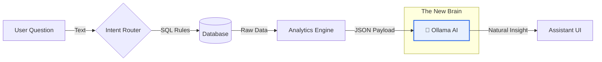

# 🧠 Ollama Retail Analytics Integration Report

## 🚀 Overview
Today we transformed the **Retail Assistant** from a simple rule-based query engine into a **Conversational AI Analyst**.

By integrating a local **Ollama** model (Qwen 2.5), the assistant can now:
1.  **Understand** your data deeply.
2.  **Explain** trends and insights in natural language.
3.  **Engage** in context-aware conversations.


---

## 🏗️ Architecture: How It Works

We built a **Hybrid System** that combines the accuracy of database queries with the fluency of an LLM.



1.  **Strict Data**: We still query your SQL database for 100% accurate numbers (Sales, Stock, etc.).
2.  **AI Narrative**: We feed those numbers to Ollama to generate the *story* behind the data.

---

## 📂 Key Changes

We touched **5 key files** to make this happen.

| File | Type | What We Did |
| :--- | :--- | :--- |
| **`ollama_chat.py`** | 🐍 Python | **Created New Module.** The bridge between your app and Ollama. It formats the data prompts. |
| **`service.py`** | 🐍 Python | **Wired the Brain.** Updated the main service to call the AI after every analytics query. |
| **`views.py`** | 🐍 Python | **Saved the Thoughts.** Configured the system to save the AI's insight into the chat history database. |
| **`settings.py`** | ⚙️ Config | **Added the Toggle.** Added `ASSISTANT_OLLAMA_CHAT_ENABLED = True` so you can turn it off anytime. |
| **`assistant.html`** | 🎨 UI | **Polished the Look.** Added the ✨ **AI Insight** card and the "Analyzing..." typing animation. |

---

## ✨ Visual Features

### 1. The AI Insight Card
Instead of just a table, you now get a highlighted insight block:

> **✨ AI Insight**
> Sales are up **15%** compared to last week! The top category is **Footwear**, driven mainly by the *Classic Leather Loafers* promo. Stock is healthy, but keep an eye on *Running Shoes*.

*(Visually styled with a soft blue gradient and specific badge)*

### 2. Typing Indicator
Because AI takes a second to think, we added a smooth animation:
`Analyzing with AI... ● ● ●`

### 3. Graceful Fallback
If Ollama is stopped or crashes? **No problem.** The system automatically falls back to the standard rule-based summary (the "Before" state).


*(The standard view filters back in if AI is offline)*

---

## 🛠️ How to Manage It

**Start the Brain:**
```bash
ollama serve
```

**Run the App:**
```bash
python manage.py runserver
```

**Toggle it Off:**
In `settings.py`:
```python
ASSISTANT_OLLAMA_CHAT_ENABLED = False
```

---
*Generated by Antigravity*
