# System Flow Breakdown

### 1. Inventory Module
The backbone of the system that manages all product data and tracks exactly how quantities change over time.
*   **Product List Tab**: The master database displaying all existing products, their categories, pricing, and current stock counts.
    *   **Create Product**: When a user clicks this button, a new product record is added to the database. If an initial quantity is set, it triggers an "Initial" or "Stock In" entry in the Stock Movement log.
*   **Stock Movement History Tab**: A comprehensive audit log that tracks every single change in product quantities.
    *   **Stock In**: Used for manual inventory additions. It increases the product's stock count and logs a "Stock In" movement type.
    *   **Stock Out**: Used for manual deductions (e.g., for damaged goods or expired items). It decreases the stock count and logs a "Stock Out" movement type.
    *   **Adjust**: Used during inventory audits. It overwrites the current stock count with a newly counted value, logging an "Adjustment" movement type for the exact difference.

### 2. Sales Module
Handles all customer-facing transactions and revenue tracking.
*   **New Sale Tab**: The Point of Sale (POS) interface.
    *   **When a New Sale happens**: 
        1. The module fetches current product details and prices from the **Inventory Module**.
        2. Once the checkout is completed, it generates a transaction record.
        3. **Cross-Module Effect**: It automatically triggers a deduction in the **Inventory Module**, reducing the sold quantities from the current stock. This deduction automatically appears in the **Stock Movement History** as a "Sale" movement type.
*   **Sales History Tab**: A chronological ledger of all completed transactions (showing date, total amount, and cashier).
*   **Sale Details Tab**: Allows the user to click into any specific transaction from the Sales History to view an itemized breakdown of what was sold, taxes, and payment methods.

### 3. Suppliers Module
Manages the procurement side of the business to ensure products stay in stock.
*   **Suppliers Tab**: A directory tracking vendor profiles, contact information, and lead times.
*   **Purchase Orders Tab**: Manages formal requests sent to suppliers for new goods.
    *   **Cross-Module Effect**: When a Purchase Order is marked as "Received" or "Completed", it automatically updates the **Inventory Module**, adding the received quantities to the respective products. This logs a "Purchase" or "Stock In" entry in the **Stock Movement History**.
*   **Reorder Tab**: Constantly queries the **Inventory Module** to compare current stock against predefined "minimum safety stock" thresholds. If an item is low, it alerts the user and allows them to instantly generate a Purchase Order for the linked supplier.

### 4. Dashboard Module
The central command center. It operates as a read-only analytics layer that aggregates real-time data from all other modules to give the user a high-level snapshot.
*   **From Sales**: It pulls in transaction data to display daily/monthly revenue metrics and top-selling product charts.
*   **From Inventory**: It highlights critical low-stock alerts and calculates total inventory valuation.
*   **From Suppliers**: It displays the status of pending purchase orders and recent deliveries.

### 5. Assistant Module
An intelligent, AI-powered integration (via Ollama) that sits on top of the entire system as an analytical overlay.
*   **How it works**: It has read-access to the databases of the Inventory, Sales, and Supplier modules.
*   **Functionality**: Instead of the user manually clicking through tabs to compile data, they can ask natural language questions in the chat interface (e.g., *"What were our top 3 products last week?"* or *"Which suppliers are late on their POs?"*). The Assistant instantly queries the underlying modules, processes the raw data, and returns conversational summaries and deep insights.

---

### Flow Diagram

![System Flow Diagram](https://mermaid.ink/img/eyJjb2RlIjogImZsb3djaGFydCBURFxuICAgIGNsYXNzRGVmIG1vZHVsZSBmaWxsOiNlMWY1ZmUsc3Ryb2tlOiMwM2E5ZjQsc3Ryb2tlLXdpZHRoOjJweDtcbiAgICBjbGFzc0RlZiBhY3Rpb24gZmlsbDojZmZmLHN0cm9rZTojYjNlNWZjLHN0cm9rZS13aWR0aDoxcHg7XG5cbiAgICBzdWJncmFwaCBEYXNoYm9hcmQgW0Rhc2hib2FyZCBNb2R1bGVdXG4gICAgICAgIERfTWV0cmljcyhSZXZlbnVlICYgU2FsZXMgQ2hhcnRzKVxuICAgICAgICBEX0FsZXJ0cyhMb3cgU3RvY2sgJiBQTyBBbGVydHMpXG4gICAgZW5kXG4gICAgY2xhc3MgRGFzaGJvYXJkIG1vZHVsZVxuXG4gICAgc3ViZ3JhcGggQXNzaXN0YW50IFtBc3Npc3RhbnQgTW9kdWxlXVxuICAgICAgICBBX0NoYXQoT2xsYW1hIENoYXQgSW50ZXJmYWNlKVxuICAgICAgICBBX0FuYWx5dGljcyhOYXR1cmFsIExhbmd1YWdlIEFuYWx5dGljcylcbiAgICBlbmRcbiAgICBjbGFzcyBBc3Npc3RhbnQgbW9kdWxlXG5cbiAgICBzdWJncmFwaCBJbnZlbnRvcnkgW0ludmVudG9yeSBNb2R1bGVdXG4gICAgICAgIElfTGlzdChQcm9kdWN0IExpc3QpXG4gICAgICAgIElfSGlzdG9yeShTdG9jayBNb3ZlbWVudCBIaXN0b3J5KVxuICAgICAgICBcbiAgICAgICAgSV9CdXR0b25zW0NyZWF0ZSAvIFN0b2NrIEluIC8gU3RvY2sgT3V0IC8gQWRqdXN0XVxuICAgIGVuZFxuICAgIGNsYXNzIEludmVudG9yeSBtb2R1bGVcblxuICAgIHN1YmdyYXBoIFNhbGVzIFtTYWxlcyBNb2R1bGVdXG4gICAgICAgIFNfTmV3KE5ldyBTYWxlKVxuICAgICAgICBTX0hpc3RvcnkoU2FsZXMgSGlzdG9yeSlcbiAgICAgICAgU19EZXRhaWxzKFNhbGUgRGV0YWlscylcbiAgICBlbmRcbiAgICBjbGFzcyBTYWxlcyBtb2R1bGVcblxuICAgIHN1YmdyYXBoIFN1cHBsaWVycyBbU3VwcGxpZXJzIE1vZHVsZV1cbiAgICAgICAgU3VwX0RpcihTdXBwbGllcnMgTGlzdClcbiAgICAgICAgU3VwX1BPKFB1cmNoYXNlIE9yZGVycylcbiAgICAgICAgU3VwX1Jlb3JkZXIoUmVvcmRlciBBbGVydHMpXG4gICAgZW5kXG4gICAgY2xhc3MgU3VwcGxpZXJzIG1vZHVsZVxuXG4gICAgU19OZXcgLS0gXCIxLiBGZXRjaGVzIFByaWNlcy9EZXRhaWxzXCIgLS0-IElfTGlzdFxuICAgIFNfTmV3IC0tIFwiMi4gRGVkdWN0cyBTdG9ja1xcbihMb2dzIFNhbGUgTW92ZW1lbnQpXCIgLS0-IElfSGlzdG9yeVxuICAgIFNfTmV3IC0tIFwiMy4gU2F2ZXMgVHJhbnNhY3Rpb25cIiAtLT4gU19IaXN0b3J5XG4gICAgU19IaXN0b3J5IC0tIFwiVmlldyBJdGVtaXplZFwiIC0tPiBTX0RldGFpbHNcblxuICAgIFN1cF9SZW9yZGVyIC0tIFwiRGV0ZWN0cyBMb3cgU3RvY2tcIiAtLT4gSV9MaXN0XG4gICAgU3VwX1Jlb3JkZXIgLS0gXCJHZW5lcmF0ZXNcIiAtLT4gU3VwX1BPXG4gICAgU3VwX1BPIC0tIFwiTWFya3MgUmVjZWl2ZWQgLyBBZGRzIFN0b2NrXFxuKExvZ3MgUHVyY2hhc2UgTW92ZW1lbnQpXCIgLS0-IElfSGlzdG9yeVxuXG4gICAgSV9CdXR0b25zIC0tIFwiQXBwbGllcyBNYW51YWwgQ2hhbmdlc1xcbihMb2dzIEluL091dC9BZGp1c3QpXCIgLS0-IElfSGlzdG9yeVxuICAgIElfQnV0dG9ucyAtLSBcIkFkZHMgTmV3IEl0ZW1cIiAtLT4gSV9MaXN0XG5cbiAgICBTX0hpc3RvcnkgLS4gXCJGZWVkcyBSZXZlbnVlIERhdGFcIiAuLT4gRF9NZXRyaWNzXG4gICAgSV9MaXN0IC0uIFwiRmVlZHMgU3RvY2sgTGV2ZWxzXCIgLi0-IERfQWxlcnRzXG4gICAgU3VwX1BPIC0uIFwiRmVlZHMgT3JkZXIgU3RhdHVzXCIgLi0-IERfQWxlcnRzXG5cbiAgICBJX0hpc3RvcnkgLS4gXCJSZWFkcyBEYXRhXCIgLi0-IEFfQW5hbHl0aWNzXG4gICAgU19IaXN0b3J5IC0uIFwiUmVhZHMgRGF0YVwiIC4tPiBBX0FuYWx5dGljc1xuICAgIFN1cF9QTyAtLiBcIlJlYWRzIERhdGFcIiAuLT4gQV9BbmFseXRpY3NcbiAgICBJX0xpc3QgLS4gXCJSZWFkcyBEYXRhXCIgLi0-IEFfQW5hbHl0aWNzXG4gICAgQV9BbmFseXRpY3MgLS0gXCJHZW5lcmF0ZXMgSW5zaWdodHNcXG4mIEFuc3dlcnNcIiAtLT4gQV9DaGF0IiwgIm1lcm1haWQiOiAie1widGhlbWVcIjpcImRlZmF1bHRcIn0ifQ==)

---

### Overall Sequence Diagram
This sequence diagram reflects the implemented Django flow in this project, including login with email 2FA and trusted devices, core operational writes, assistant conversations, and forecast import feeding the dashboard.

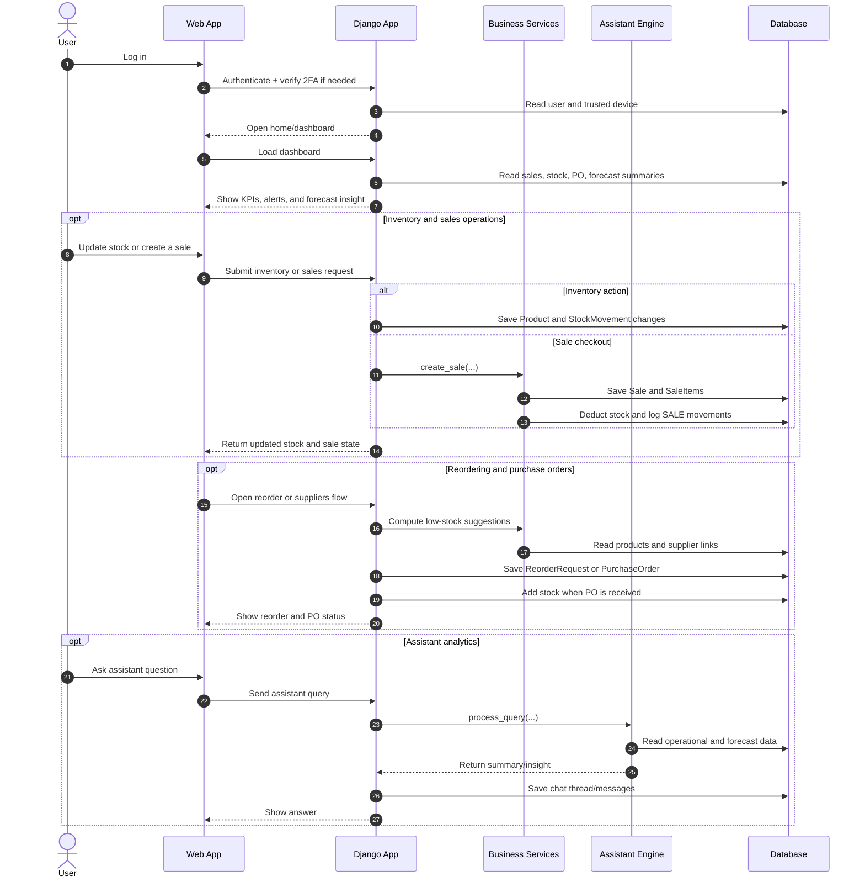

[Open Rendered Overall Sequence Diagram](https://mermaid.ink/img/eyJjb2RlIjogInNlcXVlbmNlRGlhZ3JhbVxuICAgIGF1dG9udW1iZXJcbiAgICBhY3RvciBVc2VyXG4gICAgcGFydGljaXBhbnQgVUkgYXMgV2ViIEFwcFxuICAgIHBhcnRpY2lwYW50IEFwcCBhcyBEamFuZ28gQXBwXG4gICAgcGFydGljaXBhbnQgU3ZjIGFzIEJ1c2luZXNzIFNlcnZpY2VzXG4gICAgcGFydGljaXBhbnQgQUkgYXMgQXNzaXN0YW50IEVuZ2luZVxuICAgIHBhcnRpY2lwYW50IERCIGFzIERhdGFiYXNlXG5cbiAgICBVc2VyLT4-VUk6IExvZyBpblxuICAgIFVJLT4-QXBwOiBBdXRoZW50aWNhdGUgKyB2ZXJpZnkgMkZBIGlmIG5lZWRlZFxuICAgIEFwcC0-PkRCOiBSZWFkIHVzZXIgYW5kIHRydXN0ZWQgZGV2aWNlXG4gICAgQXBwLS0-PlVJOiBPcGVuIGhvbWUvZGFzaGJvYXJkXG5cbiAgICBVSS0-PkFwcDogTG9hZCBkYXNoYm9hcmRcbiAgICBBcHAtPj5EQjogUmVhZCBzYWxlcywgc3RvY2ssIFBPLCBmb3JlY2FzdCBzdW1tYXJpZXNcbiAgICBBcHAtLT4-VUk6IFNob3cgS1BJcywgYWxlcnRzLCBhbmQgZm9yZWNhc3QgaW5zaWdodFxuXG4gICAgb3B0IEludmVudG9yeSBhbmQgc2FsZXMgb3BlcmF0aW9uc1xuICAgICAgICBVc2VyLT4-VUk6IFVwZGF0ZSBzdG9jayBvciBjcmVhdGUgYSBzYWxlXG4gICAgICAgIFVJLT4-QXBwOiBTdWJtaXQgaW52ZW50b3J5IG9yIHNhbGVzIHJlcXVlc3RcbiAgICAgICAgYWx0IEludmVudG9yeSBhY3Rpb25cbiAgICAgICAgICAgIEFwcC0-PkRCOiBTYXZlIFByb2R1Y3QgYW5kIFN0b2NrTW92ZW1lbnQgY2hhbmdlc1xuICAgICAgICBlbHNlIFNhbGUgY2hlY2tvdXRcbiAgICAgICAgICAgIEFwcC0-PlN2YzogY3JlYXRlX3NhbGUoLi4uKVxuICAgICAgICAgICAgU3ZjLT4-REI6IFNhdmUgU2FsZSBhbmQgU2FsZUl0ZW1zXG4gICAgICAgICAgICBTdmMtPj5EQjogRGVkdWN0IHN0b2NrIGFuZCBsb2cgU0FMRSBtb3ZlbWVudHNcbiAgICAgICAgZW5kXG4gICAgICAgIEFwcC0tPj5VSTogUmV0dXJuIHVwZGF0ZWQgc3RvY2sgYW5kIHNhbGUgc3RhdGVcbiAgICBlbmRcblxuICAgIG9wdCBSZW9yZGVyaW5nIGFuZCBwdXJjaGFzZSBvcmRlcnNcbiAgICAgICAgVUktPj5BcHA6IE9wZW4gcmVvcmRlciBvciBzdXBwbGllcnMgZmxvd1xuICAgICAgICBBcHAtPj5TdmM6IENvbXB1dGUgbG93LXN0b2NrIHN1Z2dlc3Rpb25zXG4gICAgICAgIFN2Yy0-PkRCOiBSZWFkIHByb2R1Y3RzIGFuZCBzdXBwbGllciBsaW5rc1xuICAgICAgICBBcHAtPj5EQjogU2F2ZSBSZW9yZGVyUmVxdWVzdCBvciBQdXJjaGFzZU9yZGVyXG4gICAgICAgIEFwcC0-PkRCOiBBZGQgc3RvY2sgd2hlbiBQTyBpcyByZWNlaXZlZFxuICAgICAgICBBcHAtLT4-VUk6IFNob3cgcmVvcmRlciBhbmQgUE8gc3RhdHVzXG4gICAgZW5kXG5cbiAgICBvcHQgQXNzaXN0YW50IGFuYWx5dGljc1xuICAgICAgICBVc2VyLT4-VUk6IEFzayBhc3Npc3RhbnQgcXVlc3Rpb25cbiAgICAgICAgVUktPj5BcHA6IFNlbmQgYXNzaXN0YW50IHF1ZXJ5XG4gICAgICAgIEFwcC0-PkFJOiBwcm9jZXNzX3F1ZXJ5KC4uLilcbiAgICAgICAgQUktPj5EQjogUmVhZCBvcGVyYXRpb25hbCBhbmQgZm9yZWNhc3QgZGF0YVxuICAgICAgICBBSS0tPj5BcHA6IFJldHVybiBzdW1tYXJ5L2luc2lnaHRcbiAgICAgICAgQXBwLT4-REI6IFNhdmUgY2hhdCB0aHJlYWQvbWVzc2FnZXNcbiAgICAgICAgQXBwLS0-PlVJOiBTaG93IGFuc3dlclxuICAgIGVuZCIsICJtZXJtYWlkIjogIntcInRoZW1lXCI6XCJkZWZhdWx0XCJ9In0)

### Detailed Shapes Diagram
(Includes Databases, Decisions, I/O Parallelograms, and Process Rectangles)

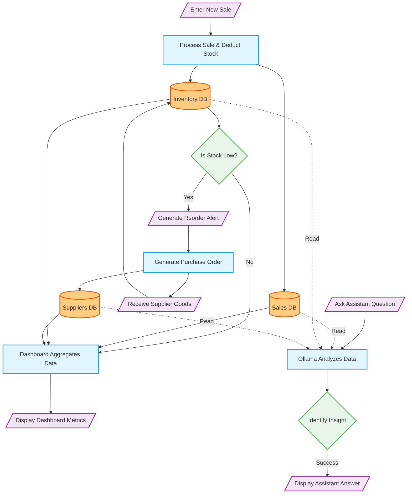

![Detailed Shapes Flow Diagram](https://mermaid.ink/img/eyJjb2RlIjogImZsb3djaGFydCBURFxuICAgIGNsYXNzRGVmIGRiIGZpbGw6I2ZmY2M4MCxzdHJva2U6I2U2NTEwMCxzdHJva2Utd2lkdGg6MnB4O1xuICAgIGNsYXNzRGVmIHByb2Nlc3MgZmlsbDojZTFmNWZlLHN0cm9rZTojMDNhOWY0LHN0cm9rZS13aWR0aDoycHg7XG4gICAgY2xhc3NEZWYgZGVjaXNpb24gZmlsbDojZThmNWU5LHN0cm9rZTojNGNhZjUwLHN0cm9rZS13aWR0aDoycHg7XG4gICAgY2xhc3NEZWYgaW8gZmlsbDojZjNlNWY1LHN0cm9rZTojOWMyN2IwLHN0cm9rZS13aWR0aDoycHg7XG5cbiAgICAlJSBEYXRhYmFzZXMgKEN5bGluZGVyKVxuICAgIEludl9EQlsoSW52ZW50b3J5IERCKV06OjpkYlxuICAgIFNhbGVfREJbKFNhbGVzIERCKV06OjpkYlxuICAgIFN1cF9EQlsoU3VwcGxpZXJzIERCKV06OjpkYlxuXG4gICAgJSUgVXNlciBJbnB1dHMgLyBPdXRwdXRzIChQYXJhbGxlbG9ncmFtKVxuICAgIElucHV0X1NhbGVbL0VudGVyIE5ldyBTYWxlL106Ojppb1xuICAgIElucHV0X1BPWy9SZWNlaXZlIFN1cHBsaWVyIEdvb2RzL106Ojppb1xuICAgIElucHV0X1F1ZXJ5Wy9Bc2sgQXNzaXN0YW50IFF1ZXN0aW9uL106Ojppb1xuICAgIE91dF9EYXNoWy9EaXNwbGF5IERhc2hib2FyZCBNZXRyaWNzL106Ojppb1xuICAgIE91dF9BbnN3ZXJbL0Rpc3BsYXkgQXNzaXN0YW50IEFuc3dlci9dOjo6aW9cbiAgICBPdXRfQWxlcnRbL0dlbmVyYXRlIFJlb3JkZXIgQWxlcnQvXTo6OmlvXG5cbiAgICAlJSBQcm9jZXNzZXMgKFJlY3RhbmdsZSlcbiAgICBQcm9jX1NhbGVbUHJvY2VzcyBTYWxlICYgRGVkdWN0IFN0b2NrXTo6OnByb2Nlc3NcbiAgICBQcm9jX0FnZ1tEYXNoYm9hcmQgQWdncmVnYXRlcyBEYXRhXTo6OnByb2Nlc3NcbiAgICBQcm9jX0FJW09sbGFtYSBBbmFseXplcyBEYXRhXTo6OnByb2Nlc3NcbiAgICBQcm9jX1BPW0dlbmVyYXRlIFB1cmNoYXNlIE9yZGVyXTo6OnByb2Nlc3NcblxuICAgICUlIERlY2lzaW9ucyAoRGlhbW9uZClcbiAgICBEZWNfU3RvY2t7SXMgU3RvY2sgTG93P306OjpkZWNpc2lvblxuICAgIERlY19SZXNwb25zZXtJZGVudGlmeSBJbnNpZ2h0fTo6OmRlY2lzaW9uXG5cbiAgICAlJSBGbG93IC0gU2FsZXNcbiAgICBJbnB1dF9TYWxlIC0tPiBQcm9jX1NhbGVcbiAgICBQcm9jX1NhbGUgLS0-IFNhbGVfREJcbiAgICBQcm9jX1NhbGUgLS0-IEludl9EQlxuXG4gICAgJSUgRmxvdyAtIEludmVudG9yeSAmIFN1cHBsaWVyc1xuICAgIEludl9EQiAtLT4gRGVjX1N0b2NrXG4gICAgRGVjX1N0b2NrIC0tIFllcyAtLT4gT3V0X0FsZXJ0XG4gICAgT3V0X0FsZXJ0IC0tPiBQcm9jX1BPXG4gICAgUHJvY19QTyAtLT4gU3VwX0RCXG4gICAgUHJvY19QTyAtLT4gSW5wdXRfUE9cbiAgICBJbnB1dF9QTyAtLT4gSW52X0RCXG4gICAgRGVjX1N0b2NrIC0tIE5vIC0tPiBQcm9jX0FnZ1xuXG4gICAgJSUgRmxvdyAtIERhc2hib2FyZFxuICAgIFNhbGVfREIgLS0-IFByb2NfQWdnXG4gICAgSW52X0RCIC0tPiBQcm9jX0FnZ1xuICAgIFN1cF9EQiAtLT4gUHJvY19BZ2dcbiAgICBQcm9jX0FnZyAtLT4gT3V0X0Rhc2hcblxuICAgICUlIEZsb3cgLSBBc3Npc3RhbnRcbiAgICBJbnB1dF9RdWVyeSAtLT4gUHJvY19BSVxuICAgIFNhbGVfREIgLS4gUmVhZCAuLT4gUHJvY19BSVxuICAgIEludl9EQiAtLiBSZWFkIC4tPiBQcm9jX0FJXG4gICAgU3VwX0RCIC0uIFJlYWQgLi0-IFByb2NfQUlcbiAgICBQcm9jX0FJIC0tPiBEZWNfUmVzcG9uc2VcbiAgICBEZWNfUmVzcG9uc2UgLS0gU3VjY2VzcyAtLT4gT3V0X0Fuc3dlciIsICJtZXJtYWlkIjogIntcInRoZW1lXCI6XCJkZWZhdWx0XCJ9In0=)

---

## Individual Module Flow Diagrams

Here are the detailed, shape-based flow diagrams broken down for each specific module.

### Inventory Module Diagram

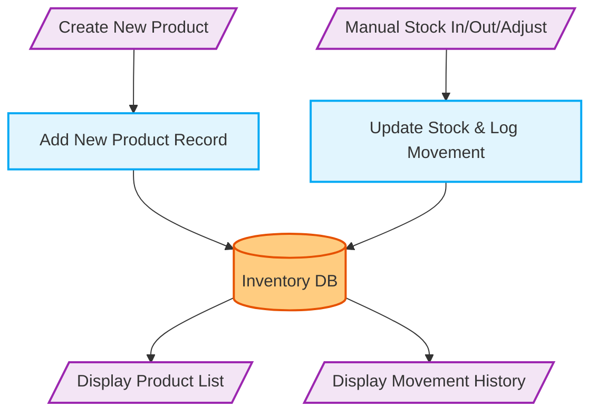

![Inventory Module Diagram](https://mermaid.ink/img/eyJjb2RlIjogImZsb3djaGFydCBURFxuICAgIGNsYXNzRGVmIGRiIGZpbGw6I2ZmY2M4MCxzdHJva2U6I2U2NTEwMCxzdHJva2Utd2lkdGg6MnB4O1xuICAgIGNsYXNzRGVmIHByb2Nlc3MgZmlsbDojZTFmNWZlLHN0cm9rZTojMDNhOWY0LHN0cm9rZS13aWR0aDoycHg7XG4gICAgY2xhc3NEZWYgZGVjaXNpb24gZmlsbDojZThmNWU5LHN0cm9rZTojNGNhZjUwLHN0cm9rZS13aWR0aDoycHg7XG4gICAgY2xhc3NEZWYgaW8gZmlsbDojZjNlNWY1LHN0cm9rZTojOWMyN2IwLHN0cm9rZS13aWR0aDoycHg7XG5cbiAgICAlJSBEYXRhYmFzZXNcbiAgICBJbnZfREJbKEludmVudG9yeSBEQildOjo6ZGJcblxuICAgICUlIElPXG4gICAgSW5fU3RvY2tbL01hbnVhbCBTdG9jayBJbi9PdXQvQWRqdXN0L106Ojppb1xuICAgIEluX1Byb2R1Y3RbL0NyZWF0ZSBOZXcgUHJvZHVjdC9dOjo6aW9cbiAgICBPdXRfSGlzdG9yeVsvRGlzcGxheSBNb3ZlbWVudCBIaXN0b3J5L106Ojppb1xuICAgIE91dF9MaXN0Wy9EaXNwbGF5IFByb2R1Y3QgTGlzdC9dOjo6aW9cblxuICAgICUlIFByb2Nlc3Nlc1xuICAgIFByb2NfQWRkW0FkZCBOZXcgUHJvZHVjdCBSZWNvcmRdOjo6cHJvY2Vzc1xuICAgIFByb2NfTW92ZVtVcGRhdGUgU3RvY2sgJiBMb2cgTW92ZW1lbnRdOjo6cHJvY2Vzc1xuXG4gICAgJSUgRmxvd1xuICAgIEluX1Byb2R1Y3QgLS0-IFByb2NfQWRkIC0tPiBJbnZfREJcbiAgICBJbl9TdG9jayAtLT4gUHJvY19Nb3ZlIC0tPiBJbnZfREJcbiAgICBcbiAgICBJbnZfREIgLS0-IE91dF9MaXN0XG4gICAgSW52X0RCIC0tPiBPdXRfSGlzdG9yeSIsICJtZXJtYWlkIjogIntcInRoZW1lXCI6XCJkZWZhdWx0XCJ9In0=)

### Sales Module Diagram

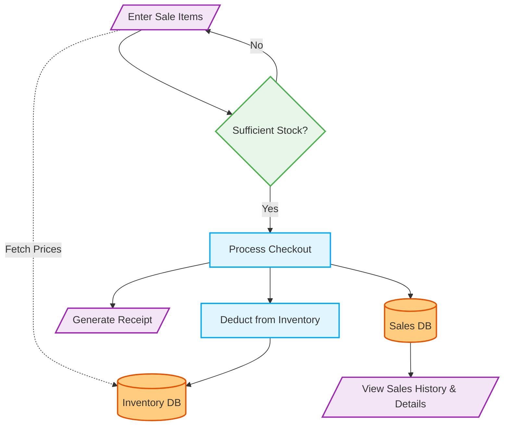

![Sales Module Diagram](https://mermaid.ink/img/eyJjb2RlIjogImZsb3djaGFydCBURFxuICAgIGNsYXNzRGVmIGRiIGZpbGw6I2ZmY2M4MCxzdHJva2U6I2U2NTEwMCxzdHJva2Utd2lkdGg6MnB4O1xuICAgIGNsYXNzRGVmIHByb2Nlc3MgZmlsbDojZTFmNWZlLHN0cm9rZTojMDNhOWY0LHN0cm9rZS13aWR0aDoycHg7XG4gICAgY2xhc3NEZWYgZGVjaXNpb24gZmlsbDojZThmNWU5LHN0cm9rZTojNGNhZjUwLHN0cm9rZS13aWR0aDoycHg7XG4gICAgY2xhc3NEZWYgaW8gZmlsbDojZjNlNWY1LHN0cm9rZTojOWMyN2IwLHN0cm9rZS13aWR0aDoycHg7XG5cbiAgICBJbnZfREJbKEludmVudG9yeSBEQildOjo6ZGJcbiAgICBTYWxlX0RCWyhTYWxlcyBEQildOjo6ZGJcblxuICAgIEluX1NhbGVbL0VudGVyIFNhbGUgSXRlbXMvXTo6OmlvXG4gICAgT3V0X1JlY2VpcHRbL0dlbmVyYXRlIFJlY2VpcHQvXTo6OmlvXG4gICAgT3V0X0hpc3RvcnlbL1ZpZXcgU2FsZXMgSGlzdG9yeSAmIERldGFpbHMvXTo6OmlvXG5cbiAgICBQcm9jX0NoZWNrb3V0W1Byb2Nlc3MgQ2hlY2tvdXRdOjo6cHJvY2Vzc1xuICAgIFByb2NfRGVkdWN0W0RlZHVjdCBmcm9tIEludmVudG9yeV06Ojpwcm9jZXNzXG5cbiAgICBEZWNfU3RvY2t7U3VmZmljaWVudCBTdG9jaz99Ojo6ZGVjaXNpb25cblxuICAgIEluX1NhbGUgLS4gRmV0Y2ggUHJpY2VzIC4tPiBJbnZfREJcbiAgICBcbiAgICBJbl9TYWxlIC0tPiBEZWNfU3RvY2tcbiAgICBEZWNfU3RvY2sgLS0gWWVzIC0tPiBQcm9jX0NoZWNrb3V0XG4gICAgRGVjX1N0b2NrIC0tIE5vIC0tPiBJbl9TYWxlXG4gICAgXG4gICAgUHJvY19DaGVja291dCAtLT4gUHJvY19EZWR1Y3QgLS0-IEludl9EQlxuICAgIFByb2NfQ2hlY2tvdXQgLS0-IFNhbGVfREJcbiAgICBQcm9jX0NoZWNrb3V0IC0tPiBPdXRfUmVjZWlwdFxuICAgIFxuICAgIFNhbGVfREIgLS0-IE91dF9IaXN0b3J5IiwgIm1lcm1haWQiOiAie1widGhlbWVcIjpcImRlZmF1bHRcIn0ifQ==)

### Suppliers Module Diagram

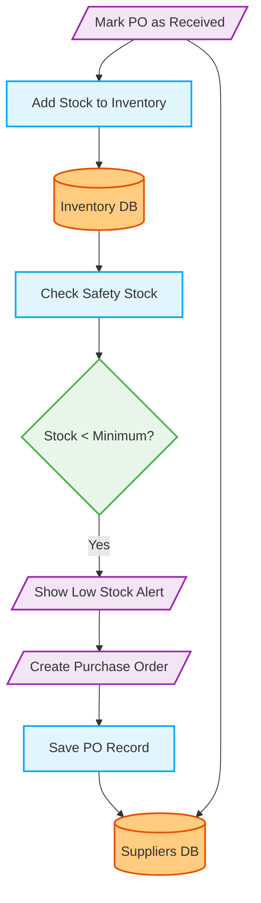

![Suppliers Module Diagram](https://mermaid.ink/img/eyJjb2RlIjogImZsb3djaGFydCBURFxuICAgIGNsYXNzRGVmIGRiIGZpbGw6I2ZmY2M4MCxzdHJva2U6I2U2NTEwMCxzdHJva2Utd2lkdGg6MnB4O1xuICAgIGNsYXNzRGVmIHByb2Nlc3MgZmlsbDojZTFmNWZlLHN0cm9rZTojMDNhOWY0LHN0cm9rZS13aWR0aDoycHg7XG4gICAgY2xhc3NEZWYgZGVjaXNpb24gZmlsbDojZThmNWU5LHN0cm9rZTojNGNhZjUwLHN0cm9rZS13aWR0aDoycHg7XG4gICAgY2xhc3NEZWYgaW8gZmlsbDojZjNlNWY1LHN0cm9rZTojOWMyN2IwLHN0cm9rZS13aWR0aDoycHg7XG5cbiAgICBJbnZfREJbKEludmVudG9yeSBEQildOjo6ZGJcbiAgICBTdXBfREJbKFN1cHBsaWVycyBEQildOjo6ZGJcblxuICAgIEluX1BPWy9DcmVhdGUgUHVyY2hhc2UgT3JkZXIgL106Ojppb1xuICAgIEluX1JlY2VpdmVbL01hcmsgUE8gYXMgUmVjZWl2ZWQvXTo6OmlvXG4gICAgT3V0X0FsZXJ0Wy9TaG93IExvdyBTdG9jayBBbGVydC9dOjo6aW9cblxuICAgIFByb2NfQ2hlY2tbQ2hlY2sgU2FmZXR5IFN0b2NrXTo6OnByb2Nlc3NcbiAgICBQcm9jX1NhdmVQT1tTYXZlIFBPIFJlY29yZF06Ojpwcm9jZXNzXG4gICAgUHJvY19BZGRTdG9ja1tBZGQgU3RvY2sgdG8gSW52ZW50b3J5XTo6OnByb2Nlc3NcblxuICAgIERlY19Mb3d7U3RvY2sgPCBNaW5pbXVtP306OjpkZWNpc2lvblxuXG4gICAgSW52X0RCIC0tPiBQcm9jX0NoZWNrIC0tPiBEZWNfTG93XG4gICAgRGVjX0xvdyAtLSBZZXMgLS0-IE91dF9BbGVydFxuICAgIE91dF9BbGVydCAtLT4gSW5fUE9cbiAgICBcbiAgICBJbl9QTyAtLT4gUHJvY19TYXZlUE8gLS0-IFN1cF9EQlxuICAgIEluX1JlY2VpdmUgLS0-IFN1cF9EQlxuICAgIEluX1JlY2VpdmUgLS0-IFByb2NfQWRkU3RvY2sgLS0-IEludl9EQiIsICJtZXJtYWlkIjogIntcInRoZW1lXCI6XCJkZWZhdWx0XCJ9In0=)

### Dashboard Module Diagram

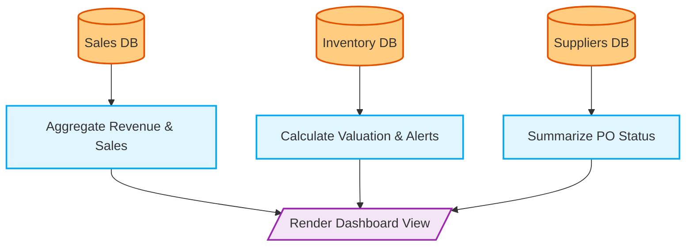

![Dashboard Module Diagram](https://mermaid.ink/img/eyJjb2RlIjogImZsb3djaGFydCBURFxuICAgIGNsYXNzRGVmIGRiIGZpbGw6I2ZmY2M4MCxzdHJva2U6I2U2NTEwMCxzdHJva2Utd2lkdGg6MnB4O1xuICAgIGNsYXNzRGVmIHByb2Nlc3MgZmlsbDojZTFmNWZlLHN0cm9rZTojMDNhOWY0LHN0cm9rZS13aWR0aDoycHg7XG4gICAgY2xhc3NEZWYgZGVjaXNpb24gZmlsbDojZThmNWU5LHN0cm9rZTojNGNhZjUwLHN0cm9rZS13aWR0aDoycHg7XG4gICAgY2xhc3NEZWYgaW8gZmlsbDojZjNlNWY1LHN0cm9rZTojOWMyN2IwLHN0cm9rZS13aWR0aDoycHg7XG5cbiAgICBJbnZfREJbKEludmVudG9yeSBEQildOjo6ZGJcbiAgICBTYWxlX0RCWyhTYWxlcyBEQildOjo6ZGJcbiAgICBTdXBfREJbKFN1cHBsaWVycyBEQildOjo6ZGJcblxuICAgIFByb2NfQWdnU2FsZXNbQWdncmVnYXRlIFJldmVudWUgJiBTYWxlc106Ojpwcm9jZXNzXG4gICAgUHJvY19BZ2dJbnZbQ2FsY3VsYXRlIFZhbHVhdGlvbiAmIEFsZXJ0c106Ojpwcm9jZXNzXG4gICAgUHJvY19BZ2dQT1tTdW1tYXJpemUgUE8gU3RhdHVzXTo6OnByb2Nlc3NcblxuICAgIE91dF9EYXNoWy9SZW5kZXIgRGFzaGJvYXJkIFZpZXcvXTo6OmlvXG5cbiAgICBTYWxlX0RCIC0tPiBQcm9jX0FnZ1NhbGVzIC0tPiBPdXRfRGFzaFxuICAgIEludl9EQiAtLT4gUHJvY19BZ2dJbnYgLS0-IE91dF9EYXNoXG4gICAgU3VwX0RCIC0tPiBQcm9jX0FnZ1BPIC0tPiBPdXRfRGFzaCIsICJtZXJtYWlkIjogIntcInRoZW1lXCI6XCJkZWZhdWx0XCJ9In0=)

### Assistant Module Diagram

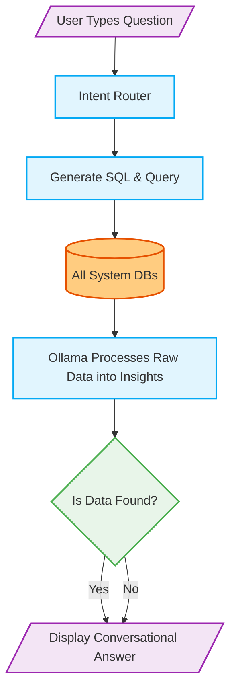

![Assistant Module Diagram](https://mermaid.ink/img/eyJjb2RlIjogImZsb3djaGFydCBURFxuICAgIGNsYXNzRGVmIGRiIGZpbGw6I2ZmY2M4MCxzdHJva2U6I2U2NTEwMCxzdHJva2Utd2lkdGg6MnB4O1xuICAgIGNsYXNzRGVmIHByb2Nlc3MgZmlsbDojZTFmNWZlLHN0cm9rZTojMDNhOWY0LHN0cm9rZS13aWR0aDoycHg7XG4gICAgY2xhc3NEZWYgZGVjaXNpb24gZmlsbDojZThmNWU5LHN0cm9rZTojNGNhZjUwLHN0cm9rZS13aWR0aDoycHg7XG4gICAgY2xhc3NEZWYgaW8gZmlsbDojZjNlNWY1LHN0cm9rZTojOWMyN2IwLHN0cm9rZS13aWR0aDoycHg7XG5cbiAgICBEQnNbKEFsbCBTeXN0ZW0gREJzKV06OjpkYlxuXG4gICAgSW5fUXVlcnlbL1VzZXIgVHlwZXMgUXVlc3Rpb24vXTo6OmlvXG4gICAgT3V0X0Fuc1svRGlzcGxheSBDb252ZXJzYXRpb25hbCBBbnN3ZXIvXTo6OmlvXG5cbiAgICBQcm9jX1JvdXRlcltJbnRlbnQgUm91dGVyXTo6OnByb2Nlc3NcbiAgICBQcm9jX1NRTFtHZW5lcmF0ZSBTUUwgJiBRdWVyeV06Ojpwcm9jZXNzXG4gICAgUHJvY19PbGxhbWFbT2xsYW1hIFByb2Nlc3NlcyBSYXcgRGF0YSBpbnRvIEluc2lnaHRzXTo6OnByb2Nlc3NcblxuICAgIERlY19WYWxpZHtJcyBEYXRhIEZvdW5kP306OjpkZWNpc2lvblxuXG4gICAgSW5fUXVlcnkgLS0-IFByb2NfUm91dGVyIC0tPiBQcm9jX1NRTFxuICAgIFByb2NfU1FMIC0tPiBEQnNcbiAgICBEQnMgLS0-IFByb2NfT2xsYW1hXG4gICAgUHJvY19PbGxhbWEgLS0-IERlY19WYWxpZFxuICAgIERlY19WYWxpZCAtLSBZZXMgLS0-IE91dF9BbnNcbiAgICBEZWNfVmFsaWQgLS0gTm8gLS0-IE91dF9BbnMiLCAibWVybWFpZCI6ICJ7XCJ0aGVtZVwiOlwiZGVmYXVsdFwifSJ9)

---

### Comprehensive End-to-End System Flow (Including Login)

This diagram represents the entire lifecycle from the user logging in, reaching the centralized dashboard, and branching out into all individual modules, showing exactly how data writes to and reads from the system databases.

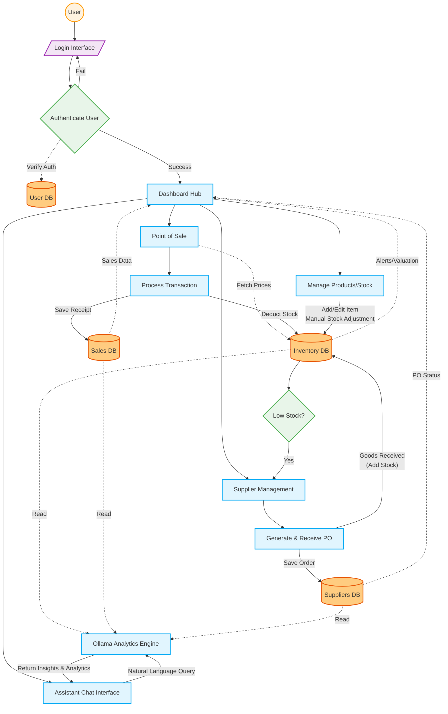

![Comprehensive End-to-End Flow Diagram](https://mermaid.ink/img/eyJjb2RlIjogImZsb3djaGFydCBURFxuICAgIGNsYXNzRGVmIGRiIGZpbGw6I2ZmY2M4MCxzdHJva2U6I2U2NTEwMCxzdHJva2Utd2lkdGg6MnB4O1xuICAgIGNsYXNzRGVmIHByb2Nlc3MgZmlsbDojZTFmNWZlLHN0cm9rZTojMDNhOWY0LHN0cm9rZS13aWR0aDoycHg7XG4gICAgY2xhc3NEZWYgZGVjaXNpb24gZmlsbDojZThmNWU5LHN0cm9rZTojNGNhZjUwLHN0cm9rZS13aWR0aDoycHg7XG4gICAgY2xhc3NEZWYgaW8gZmlsbDojZjNlNWY1LHN0cm9rZTojOWMyN2IwLHN0cm9rZS13aWR0aDoycHg7XG4gICAgY2xhc3NEZWYgdXNlciBmaWxsOiNmZmYzZTAsc3Ryb2tlOiNmZjk4MDAsc3Ryb2tlLXdpZHRoOjJweCxzaGFwZTpjaXJjbGU7XG5cbiAgICAlJSBVc2VyICYgQXV0aFxuICAgIFVzZXIoKFVzZXIpKTo6OnVzZXJcbiAgICBJbl9Mb2dpblsvTG9naW4gSW50ZXJmYWNlL106Ojppb1xuICAgIERlY19BdXRoe0F1dGhlbnRpY2F0ZSBVc2VyfTo6OmRlY2lzaW9uXG4gICAgQXV0aF9EQlsoVXNlciBEQildOjo6ZGJcblxuICAgICUlIE1haW4gSHViXG4gICAgRGFzaFtEYXNoYm9hcmQgSHViXTo6OnByb2Nlc3NcblxuICAgICUlIERhdGFiYXNlc1xuICAgIEludl9EQlsoSW52ZW50b3J5IERCKV06OjpkYlxuICAgIFNhbGVfREJbKFNhbGVzIERCKV06OjpkYlxuICAgIFN1cF9EQlsoU3VwcGxpZXJzIERCKV06OjpkYlxuXG4gICAgJSUgTW9kdWxlcyAmIFByb2Nlc3Nlc1xuICAgICUlIFNhbGVzXG4gICAgUHJvY19QT1NbUG9pbnQgb2YgU2FsZV06Ojpwcm9jZXNzXG4gICAgUHJvY19DaGVja291dFtQcm9jZXNzIFRyYW5zYWN0aW9uXTo6OnByb2Nlc3NcbiAgICBcbiAgICAlJSBJbnZlbnRvcnlcbiAgICBQcm9jX0ludk1ndFtNYW5hZ2UgUHJvZHVjdHMvU3RvY2tdOjo6cHJvY2Vzc1xuICAgIFxuICAgICUlIFN1cHBsaWVyc1xuICAgIFByb2NfU3VwTWd0W1N1cHBsaWVyIE1hbmFnZW1lbnRdOjo6cHJvY2Vzc1xuICAgIERlY19Mb3d7TG93IFN0b2NrP306OjpkZWNpc2lvblxuICAgIFByb2NfUE9bR2VuZXJhdGUgJiBSZWNlaXZlIFBPXTo6OnByb2Nlc3NcblxuICAgICUlIEFzc2lzdGFudFxuICAgIFByb2NfQ2hhdFtBc3Npc3RhbnQgQ2hhdCBJbnRlcmZhY2VdOjo6cHJvY2Vzc1xuICAgIFByb2NfT2xsYW1hW09sbGFtYSBBbmFseXRpY3MgRW5naW5lXTo6OnByb2Nlc3NcblxuICAgICUlIC0tLSBUSEUgRkxPVyAtLS1cblxuICAgICUlIEF1dGhlbnRpY2F0aW9uIEZsb3dcbiAgICBVc2VyIC0tPiBJbl9Mb2dpblxuICAgIEluX0xvZ2luIC0tPiBEZWNfQXV0aFxuICAgIERlY19BdXRoIC0uIFZlcmlmeSBBdXRoIC4tPiBBdXRoX0RCXG4gICAgRGVjX0F1dGggLS0gXCJGYWlsXCIgLS0-IEluX0xvZ2luXG4gICAgRGVjX0F1dGggLS0gXCJTdWNjZXNzXCIgLS0-IERhc2hcblxuICAgICUlIERhc2hib2FyZCBBZ2dyZWdhdGlvbiAmIE5hdmlnYXRpb25cbiAgICBTYWxlX0RCIC0uIFNhbGVzIERhdGEgLi0-IERhc2hcbiAgICBJbnZfREIgLS4gQWxlcnRzL1ZhbHVhdGlvbiAuLT4gRGFzaFxuICAgIFN1cF9EQiAtLiBQTyBTdGF0dXMgLi0-IERhc2hcblxuICAgICUlIE5hdmlnYXRpb24gZnJvbSBEYXNoYm9hcmRcbiAgICBEYXNoIC0tPiBQcm9jX1BPU1xuICAgIERhc2ggLS0-IFByb2NfSW52TWd0XG4gICAgRGFzaCAtLT4gUHJvY19TdXBNZ3RcbiAgICBEYXNoIC0tPiBQcm9jX0NoYXRcblxuICAgICUlIFNhbGVzIEVuZC10by1FbmRcbiAgICBQcm9jX1BPUyAtLiBcIkZldGNoIFByaWNlc1wiIC4tPiBJbnZfREJcbiAgICBQcm9jX1BPUyAtLT4gUHJvY19DaGVja291dFxuICAgIFByb2NfQ2hlY2tvdXQgLS0gXCJTYXZlIFJlY2VpcHRcIiAtLT4gU2FsZV9EQlxuICAgIFByb2NfQ2hlY2tvdXQgLS0gXCJEZWR1Y3QgU3RvY2tcIiAtLT4gSW52X0RCXG5cbiAgICAlJSBJbnZlbnRvcnkgRW5kLXRvLUVuZFxuICAgIFByb2NfSW52TWd0IC0tIFwiQWRkL0VkaXQgSXRlbVxuTWFudWFsIFN0b2NrIEFkanVzdG1lbnRcIiAtLT4gSW52X0RCXG5cbiAgICAlJSBTdXBwbGllcnMgRW5kLXRvLUVuZFxuICAgIEludl9EQiAtLT4gRGVjX0xvd1xuICAgIERlY19Mb3cgLS0gXCJZZXNcIiAtLT4gUHJvY19TdXBNZ3RcbiAgICBQcm9jX1N1cE1ndCAtLT4gUHJvY19QT1xuICAgIFByb2NfUE8gLS0gXCJTYXZlIE9yZGVyXCIgLS0-IFN1cF9EQlxuICAgIFByb2NfUE8gLS0gXCJHb29kcyBSZWNlaXZlZFxuKEFkZCBTdG9jaylcIiAtLT4gSW52X0RCXG5cbiAgICAlJSBBc3Npc3RhbnQgRW5kLXRvLUVuZFxuICAgIFByb2NfQ2hhdCAtLSBcIk5hdHVyYWwgTGFuZ3VhZ2UgUXVlcnlcIiAtLT4gUHJvY19PbGxhbWFcbiAgICBJbnZfREIgLS4gXCJSZWFkXCIgLi0-IFByb2NfT2xsYW1hXG4gICAgU2FsZV9EQiAtLiBcIlJlYWRcIiAuLT4gUHJvY19PbGxhbWFcbiAgICBTdXBfREIgLS4gXCJSZWFkXCIgLi0-IFByb2NfT2xsYW1hXG4gICAgUHJvY19PbGxhbWEgLS0gXCJSZXR1cm4gSW5zaWdodHMgJiBBbmFseXRpY3NcIiAtLT4gUHJvY19DaGF0IiwgIm1lcm1haWQiOiAie1widGhlbWVcIjpcImRlZmF1bHRcIn0ifQ==)

---

### System Use Case Diagram

This UML-style diagram outlines the primary actors (Admin, Manager, Cashier, and the Ollama AI) and illustrates their interactions with the major features/use cases bounded within the Retail Management System.

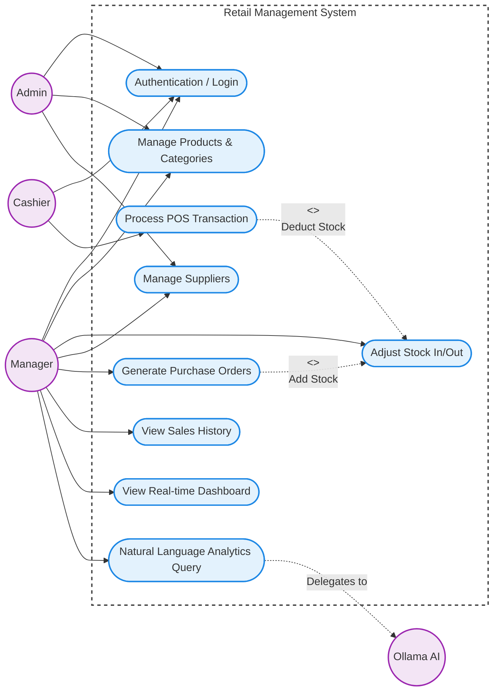

![System Use Case Diagram](https://mermaid.ink/img/eyJjb2RlIjogImZsb3djaGFydCBMUlxuICAgICUlIEFjdG9yc1xuICAgIEFkbWluKChBZG1pbikpXG4gICAgTWFuYWdlcigoTWFuYWdlcikpXG4gICAgQ2FzaGllcigoQ2FzaGllcikpXG4gICAgQUkoKE9sbGFtYSBBSSkpXG5cbiAgICAlJSBTeXN0ZW0gQm91bmRhcnlcbiAgICBzdWJncmFwaCBTeXN0ZW0gW1JldGFpbCBNYW5hZ2VtZW50IFN5c3RlbV1cbiAgICAgICAgZGlyZWN0aW9uIFRCXG4gICAgICAgIFxuICAgICAgICAlJSBHbG9iYWxcbiAgICAgICAgVUNfTG9naW4oW0F1dGhlbnRpY2F0aW9uIC8gTG9naW5dKVxuICAgICAgICBcbiAgICAgICAgJSUgSW52ZW50b3J5ICYgU3VwcGxpZXJzXG4gICAgICAgIFVDX0ludihbTWFuYWdlIFByb2R1Y3RzICYgQ2F0ZWdvcmllc10pXG4gICAgICAgIFVDX1N0b2NrKFtBZGp1c3QgU3RvY2sgSW4vT3V0XSlcbiAgICAgICAgVUNfU3VwKFtNYW5hZ2UgU3VwcGxpZXJzXSlcbiAgICAgICAgVUNfUE8oW0dlbmVyYXRlIFB1cmNoYXNlIE9yZGVyc10pXG4gICAgICAgIFxuICAgICAgICAlJSBTYWxlc1xuICAgICAgICBVQ19TYWxlKFtQcm9jZXNzIFBPUyBUcmFuc2FjdGlvbl0pXG4gICAgICAgIFVDX0hpc3QoW1ZpZXcgU2FsZXMgSGlzdG9yeV0pXG4gICAgICAgIFxuICAgICAgICAlJSBEYXNoYm9hcmQgJiBBbmFseXRpY3NcbiAgICAgICAgVUNfRGFzaChbVmlldyBSZWFsLXRpbWUgRGFzaGJvYXJkXSlcbiAgICAgICAgVUNfQ2hhdChbTmF0dXJhbCBMYW5ndWFnZSBBbmFseXRpY3MgUXVlcnldKVxuICAgIGVuZFxuXG4gICAgJSUgQWRtaW4gTGlua3NcbiAgICBBZG1pbiAtLT4gVUNfTG9naW5cbiAgICBBZG1pbiAtLT4gVUNfSW52XG4gICAgQWRtaW4gLS0-IFVDX1N1cFxuXG4gICAgJSUgTWFuYWdlciBMaW5rc1xuICAgIE1hbmFnZXIgLS0-IFVDX0xvZ2luXG4gICAgTWFuYWdlciAtLT4gVUNfSW52XG4gICAgTWFuYWdlciAtLT4gVUNfU3RvY2tcbiAgICBNYW5hZ2VyIC0tPiBVQ19TdXBcbiAgICBNYW5hZ2VyIC0tPiBVQ19QT1xuICAgIE1hbmFnZXIgLS0-IFVDX0hpc3RcbiAgICBNYW5hZ2VyIC0tPiBVQ19EYXNoXG4gICAgTWFuYWdlciAtLT4gVUNfQ2hhdFxuXG4gICAgJSUgQ2FzaGllciBMaW5rc1xuICAgIENhc2hpZXIgLS0-IFVDX0xvZ2luXG4gICAgQ2FzaGllciAtLT4gVUNfU2FsZVxuICAgIFxuICAgICUlIEFJIGxpbmtzXG4gICAgVUNfQ2hhdCAtLi0-IHxEZWxlZ2F0ZXMgdG98IEFJXG4gICAgXG4gICAgJSUgU3lzdGVtIEludGVyYWN0aW9ucyAoSW5jbHVkZXMpXG4gICAgVUNfU2FsZSAtLi0-IHw8PGluY2x1ZGVzPj5cXG5EZWR1Y3QgU3RvY2t8IFVDX1N0b2NrXG4gICAgVUNfUE8gLS4tPiB8PDxpbmNsdWRlcz4-XFxuQWRkIFN0b2NrfCBVQ19TdG9ja1xuICAgIFxuICAgICUlIFN0eWxpbmdcbiAgICBjbGFzc0RlZiBhY3RvciBmaWxsOiNmM2U1ZjUsc3Ryb2tlOiM5YzI3YjAsc3Ryb2tlLXdpZHRoOjJweDtcbiAgICBjbGFzc0RlZiB1c2VjYXNlIGZpbGw6I2UzZjJmZCxzdHJva2U6IzFlODhlNSxzdHJva2Utd2lkdGg6MnB4O1xuICAgIGNsYXNzRGVmIHN5c3RlbSBmaWxsOiNmZmZmZmYsc3Ryb2tlOiM0MjQyNDIsc3Ryb2tlLXdpZHRoOjJweCxzdHJva2UtZGFzaGFycmF5OiA1IDU7XG4gICAgXG4gICAgY2xhc3MgQWRtaW4sTWFuYWdlcixDYXNoaWVyLEFJIGFjdG9yO1xuICAgIGNsYXNzIFVDX0xvZ2luLFVDX0ludixVQ19TdG9jayxVQ19TdXAsVUNfUE8sVUNfU2FsZSxVQ19IaXN0LFVDX0Rhc2gsVUNfQ2hhdCB1c2VjYXNlO1xuICAgIGNsYXNzIFN5c3RlbSBzeXN0ZW07IiwgIm1lcm1haWQiOiAie1widGhlbWVcIjpcImRlZmF1bHRcIn0ifQ==)

---

### Overall System Flowchart (Logical Step-by-Step)

This standard flowchart focuses purely on the logical step-by-step decision pathways a user and the system can take.

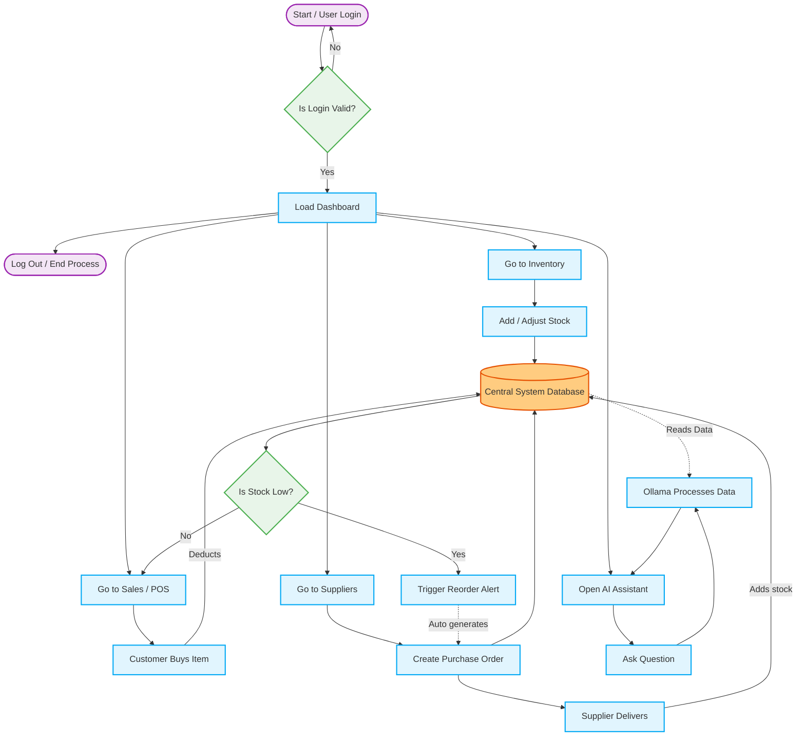

![Overall Flowchart Diagram](https://mermaid.ink/img/eyJjb2RlIjogImZsb3djaGFydCBURFxuICAgICUlIEJhc2ljIEZsb3cgRWxlbWVudHNcbiAgICBjbGFzc0RlZiBwcm9jZXNzIGZpbGw6I2UxZjVmZSxzdHJva2U6IzAzYTlmNCxzdHJva2Utd2lkdGg6MnB4O1xuICAgIGNsYXNzRGVmIGRlY2lzaW9uIGZpbGw6I2U4ZjVlOSxzdHJva2U6IzRjYWY1MCxzdHJva2Utd2lkdGg6MnB4O1xuICAgIGNsYXNzRGVmIGRhdGEgZmlsbDojZmZjYzgwLHN0cm9rZTojZTY1MTAwLHN0cm9rZS13aWR0aDoycHg7XG4gICAgY2xhc3NEZWYgdGVybSBmaWxsOiNmM2U1ZjUsc3Ryb2tlOiM5YzI3YjAsc3Ryb2tlLXdpZHRoOjJweCxzaGFwZTpwaWxsO1xuXG4gICAgU3RhcnQoW1N0YXJ0IC8gVXNlciBMb2dpbl0pOjo6dGVybVxuICAgIEVuZChbTG9nIE91dCAvIEVuZCBQcm9jZXNzXSk6Ojp0ZXJtXG5cbiAgICBEZWNfVmFsaWR7SXMgTG9naW4gVmFsaWQ_fTo6OmRlY2lzaW9uXG4gICAgRGFzaFtMb2FkIERhc2hib2FyZF06Ojpwcm9jZXNzXG4gICAgREJbKENlbnRyYWwgU3lzdGVtIERhdGFiYXNlKV06OjpkYXRhXG5cbiAgICAlJSBOYXZpZ2F0aW9uIFBhdGhzXG4gICAgTmF2X0ludltHbyB0byBJbnZlbnRvcnldOjo6cHJvY2Vzc1xuICAgIE5hdl9TYWxlW0dvIHRvIFNhbGVzIC8gUE9TXTo6OnByb2Nlc3NcbiAgICBOYXZfU3VwW0dvIHRvIFN1cHBsaWVyc106Ojpwcm9jZXNzXG4gICAgTmF2X0NoYXRbT3BlbiBBSSBBc3Npc3RhbnRdOjo6cHJvY2Vzc1xuXG4gICAgJSUgQWN0aW9uc1xuICAgIEFjdF9JbltBZGQgLyBBZGp1c3QgU3RvY2tdOjo6cHJvY2Vzc1xuICAgIEFjdF9CdXlbQ3VzdG9tZXIgQnV5cyBJdGVtXTo6OnByb2Nlc3NcbiAgICBBY3RfUE9bQ3JlYXRlIFB1cmNoYXNlIE9yZGVyXTo6OnByb2Nlc3NcbiAgICBBY3RfUXVlcnlbQXNrIFF1ZXN0aW9uXTo6OnByb2Nlc3NcbiAgICBcbiAgICBEZWNfU3RvY2t7SXMgU3RvY2sgTG93P306OjpkZWNpc2lvblxuICAgIEFjdF9SZW9yZGVyW1RyaWdnZXIgUmVvcmRlciBBbGVydF06Ojpwcm9jZXNzXG4gICAgQWN0X09sbGFtYVtPbGxhbWEgUHJvY2Vzc2VzIERhdGFdOjo6cHJvY2Vzc1xuICAgIEFjdF9EZWxpdmVyW1N1cHBsaWVyIERlbGl2ZXJzXTo6OnByb2Nlc3NcblxuICAgICUlIEZsb3cgRGV0YWlsc1xuICAgIFN0YXJ0IC0tPiBEZWNfVmFsaWRcbiAgICBEZWNfVmFsaWQgLS0gTm8gLS0-IFN0YXJ0XG4gICAgRGVjX1ZhbGlkIC0tIFllcyAtLT4gRGFzaFxuXG4gICAgJSUgRnJvbSBEYXNoYm9hcmRcbiAgICBEYXNoIC0tPiBOYXZfSW52XG4gICAgRGFzaCAtLT4gTmF2X1NhbGVcbiAgICBEYXNoIC0tPiBOYXZfU3VwXG4gICAgRGFzaCAtLT4gTmF2X0NoYXRcbiAgICBEYXNoIC0tPiBFbmRcblxuICAgICUlIEludmVudG9yeSBCcmFuY2hcbiAgICBOYXZfSW52IC0tPiBBY3RfSW5cbiAgICBBY3RfSW4gLS0-IERCXG5cbiAgICAlJSBTYWxlcyBCcmFuY2hcbiAgICBOYXZfU2FsZSAtLT4gQWN0X0J1eVxuICAgIEFjdF9CdXkgLS0gRGVkdWN0cyAtLT4gREJcbiAgICBEQiAtLT4gRGVjX1N0b2NrXG4gICAgRGVjX1N0b2NrIC0tIFllcyAtLT4gQWN0X1Jlb3JkZXJcbiAgICBEZWNfU3RvY2sgLS0gTm8gLS0-IE5hdl9TYWxlXG5cbiAgICAlJSBTdXBwbGllciBCcmFuY2hcbiAgICBOYXZfU3VwIC0tPiBBY3RfUE9cbiAgICBBY3RfUE8gLS0-IERCXG4gICAgQWN0X1Jlb3JkZXIgLS4gQXV0byBnZW5lcmF0ZXMgLi0-IEFjdF9QT1xuICAgIEFjdF9QTyAtLT4gQWN0X0RlbGl2ZXJcbiAgICBBY3RfRGVsaXZlciAtLSBBZGRzIHN0b2NrIC0tPiBEQlxuXG4gICAgJSUgQXNzaXN0YW50IEJyYW5jaFxuICAgIE5hdl9DaGF0IC0tPiBBY3RfUXVlcnlcbiAgICBBY3RfUXVlcnkgLS0-IEFjdF9PbGxhbWFcbiAgICBEQiAtLiBSZWFkcyBEYXRhIC4tPiBBY3RfT2xsYW1hXG4gICAgQWN0X09sbGFtYSAtLT4gTmF2X0NoYXQiLCAibWVybWFpZCI6ICJ7XCJ0aGVtZVwiOlwiZGVmYXVsdFwifSJ9)

---

### Core Operations Diagram (Auth, Inventory, Sales, Suppliers)

This diagram isolates the core operational modules you requested, showing what happens right after the user successfully logs into the system (from Login -> Home Page with Quick Actions -> Routing to specific modules). It also models their direct database interactions.

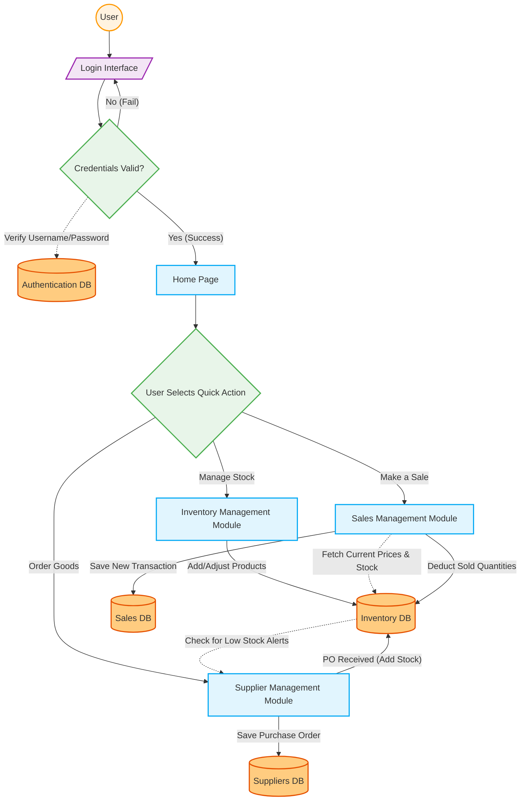

---

### Analytics Layer Diagram (Dashboard & Chatbot Implementation)

This diagram demonstrates how the analytical tools (the visual Dashboard and the natural language Chatbot) are built on top of the core modules. It illustrates how they both pull data from the main system databases to render insights without directly modifying operational data.

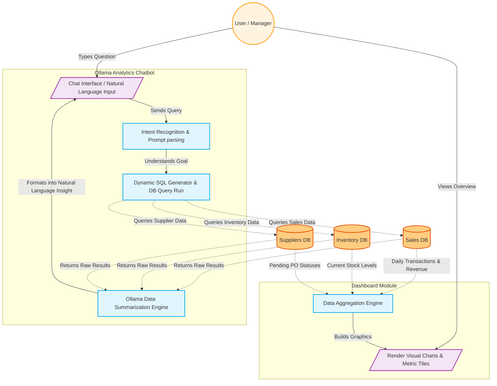

---

## Entity Relationship Diagram (Implemented Models)

This ERD is derived from [`retail_management_system/retail/models.py`](/c:/Users/baich/.vscode/retail_management_system/retail_management_system/retail/models.py). `ReorderSnooze`, `DAILYGROUPSALES`, and `SKUFORECASTGROUPMAP` are intentionally excluded from this diagram as requested. `FestiveCalendar` does not have a database FK to other tables; it enriches `DailyProductSales` through application logic.

```mermaid
erDiagram
    USER {
        int id PK
        string username
        string email
    }

    USERPROFILE {
        int id PK
        int user_id FK
        string role
    }

    TRUSTEDDEVICE {
        int id PK
        int user_id FK
        string device_id
        string token_hash
        string user_agent
        string ip_at_creation
        datetime created_at
        datetime last_used_at
        datetime expires_at
    }

    CATEGORY {
        int id PK
        string category_name UK
    }

    SKUCOUNTER {
        int id PK
        string section
        int category_id FK
        int last_seq
    }

    SUPPLIER {
        int id PK
        string supplier_name UK
        string phone
        string email
        text notes
        int lead_time_days
        bool is_active
        string contact_person
        text address
        text products_services
        int category_id FK
        datetime created_at
        datetime updated_at
    }

    PRODUCT {
        int id PK
        string sku UK
        string product_name
        int category_id FK
        int supplier_id FK
        int opening_stock
        int qty_in_stock
        string section
        decimal selling_price
        int reorder_level
        bool is_active
        datetime created_at
        datetime updated_at
    }

    PRODUCTSUPPLIER {
        int id PK
        int product_id FK
        int supplier_id FK
        decimal last_unit_cost
        int lead_time_days
        bool is_primary
    }

    STOCKMOVEMENT {
        int id PK
        datetime movement_date
        int product_id FK
        string movement_type
        int qty_moved
        string adjust_direction
        string reason
        text comments
        int created_by_id FK
        string reference
    }

    SALE {
        int id PK
        string receipt_no UK
        int cashier_id FK
        string customer_name
        string customer_phone
        decimal subtotal
        decimal discount
        decimal total
        string payment_method
        date sale_date
        datetime created_at
        bool promo_flag
    }

    SALEITEM {
        int id PK
        int sale_id FK
        int product_id FK
        int qty
        decimal unit_price
        decimal discount_pct
        decimal discount_amt
        bool promo_flag
        decimal line_total
    }

    PURCHASEORDER {
        int id PK
        int supplier_id FK
        string status
        int created_by_id FK
        datetime ordered_at
        datetime received_at
        date order_date
        date delivery_date
        decimal total_amount
        text notes
        string po_number UK
        datetime created_at
    }

    PURCHASEORDERITEM {
        int id PK
        int po_id FK
        int product_id FK
        int reorder_request_id FK
        int qty_ordered
        int qty_received
        decimal unit_cost
    }

    REORDERREQUEST {
        int id PK
        int created_by_id FK
        string status
        int supplier_id FK
        text notes
        datetime submitted_at
        datetime decided_at
        int decided_by_id FK
        text decision_note
        datetime created_at
        datetime updated_at
    }

    REORDERREQUESTITEM {
        int id PK
        int request_id FK
        int product_id FK
        int supplier_id FK
        int qty_requested
        int suggested_qty_snapshot
    }

    FESTIVECALENDAR {
        int id PK
        string festival_name
        date start_date
        date end_date
        date festival_date
        datetime created_at
        datetime updated_at
    }

    DAILYPRODUCTSALES {
        int id PK
        date date
        int product_id FK
        int category_id FK
        int qty_sold
        decimal sales_amt
        bool promo_flag
        bool is_festive
        string festival_name
        bool product_active
        bool in_stock_flag
        datetime created_at
        datetime updated_at
    }

    FORECASTRUN {
        int id PK
        string model_name
        date period_start
        date period_end
        datetime created_at
    }

    FORECASTDAILY {
        int id PK
        int run_id FK
        int product_id FK
        date forecast_date
        decimal predicted_qty
        datetime created_at
    }

    CHATTHREAD {
        int id PK
        int user_id FK
        string title
        json context_json
        bool is_archived
        datetime created_at
        datetime updated_at
    }

    CHATMESSAGE {
        int id PK
        int thread_id FK
        string role
        text content
        json payload_json
        datetime created_at
    }

    USER ||--|| USERPROFILE : has_profile
    USER ||--o{ TRUSTEDDEVICE : has
    USER ||--o{ STOCKMOVEMENT : created_by
    USER ||--o{ SALE : cashier
    USER ||--o{ PURCHASEORDER : created_by
    USER ||--o{ REORDERREQUEST : created_by
    USER o|--o{ REORDERREQUEST : decided_by
    USER ||--o{ CHATTHREAD : owns

    CATEGORY ||--o{ SKUCOUNTER : sequences
    CATEGORY ||--o{ PRODUCT : classifies
    CATEGORY o|--o{ SUPPLIER : primary_category
    CATEGORY o|--o{ DAILYPRODUCTSALES : daily_sales_category
    CATEGORY }o--o{ SUPPLIER : supplier_categories

    SUPPLIER o|--o{ PRODUCT : preferred_supplier
    SUPPLIER ||--o{ PRODUCTSUPPLIER : links
    PRODUCT ||--o{ PRODUCTSUPPLIER : supplier_links
    SUPPLIER ||--o{ PURCHASEORDER : receives
    SUPPLIER o|--o{ REORDERREQUEST : suggested_for
    SUPPLIER o|--o{ REORDERREQUESTITEM : item_supplier

    PRODUCT ||--o{ STOCKMOVEMENT : has
    PRODUCT ||--o{ SALEITEM : sold_as
    SALE ||--|{ SALEITEM : has
    PRODUCT ||--o{ PURCHASEORDERITEM : ordered_as
    PURCHASEORDER ||--|{ PURCHASEORDERITEM : has
    REORDERREQUEST o|--o{ PURCHASEORDERITEM : source_request
    REORDERREQUEST ||--|{ REORDERREQUESTITEM : has
    PRODUCT ||--o{ REORDERREQUESTITEM : requested_product

    PRODUCT ||--o{ DAILYPRODUCTSALES : daily_sales
    PRODUCT ||--o{ FORECASTDAILY : forecasted_for
    FORECASTRUN ||--|{ FORECASTDAILY : contains

    CHATTHREAD ||--|{ CHATMESSAGE : has
```

[Open Rendered ERD](https://mermaid.ink/img/eyJjb2RlIjogImVyRGlhZ3JhbVxuICAgIFVTRVIge1xuICAgICAgICBpbnQgaWQgUEtcbiAgICAgICAgc3RyaW5nIHVzZXJuYW1lXG4gICAgICAgIHN0cmluZyBlbWFpbFxuICAgIH1cblxuICAgIFVTRVJQUk9GSUxFIHtcbiAgICAgICAgaW50IGlkIFBLXG4gICAgICAgIGludCB1c2VyX2lkIEZLXG4gICAgICAgIHN0cmluZyByb2xlXG4gICAgfVxuXG4gICAgVFJVU1RFRERFVklDRSB7XG4gICAgICAgIGludCBpZCBQS1xuICAgICAgICBpbnQgdXNlcl9pZCBGS1xuICAgICAgICBzdHJpbmcgZGV2aWNlX2lkXG4gICAgICAgIHN0cmluZyB0b2tlbl9oYXNoXG4gICAgICAgIHN0cmluZyB1c2VyX2FnZW50XG4gICAgICAgIHN0cmluZyBpcF9hdF9jcmVhdGlvblxuICAgICAgICBkYXRldGltZSBjcmVhdGVkX2F0XG4gICAgICAgIGRhdGV0aW1lIGxhc3RfdXNlZF9hdFxuICAgICAgICBkYXRldGltZSBleHBpcmVzX2F0XG4gICAgfVxuXG4gICAgQ0FURUdPUlkge1xuICAgICAgICBpbnQgaWQgUEtcbiAgICAgICAgc3RyaW5nIGNhdGVnb3J5X25hbWUgVUtcbiAgICB9XG5cbiAgICBTS1VDT1VOVEVSIHtcbiAgICAgICAgaW50IGlkIFBLXG4gICAgICAgIHN0cmluZyBzZWN0aW9uXG4gICAgICAgIGludCBjYXRlZ29yeV9pZCBGS1xuICAgICAgICBpbnQgbGFzdF9zZXFcbiAgICB9XG5cbiAgICBTVVBQTElFUiB7XG4gICAgICAgIGludCBpZCBQS1xuICAgICAgICBzdHJpbmcgc3VwcGxpZXJfbmFtZSBVS1xuICAgICAgICBzdHJpbmcgcGhvbmVcbiAgICAgICAgc3RyaW5nIGVtYWlsXG4gICAgICAgIHRleHQgbm90ZXNcbiAgICAgICAgaW50IGxlYWRfdGltZV9kYXlzXG4gICAgICAgIGJvb2wgaXNfYWN0aXZlXG4gICAgICAgIHN0cmluZyBjb250YWN0X3BlcnNvblxuICAgICAgICB0ZXh0IGFkZHJlc3NcbiAgICAgICAgdGV4dCBwcm9kdWN0c19zZXJ2aWNlc1xuICAgICAgICBpbnQgY2F0ZWdvcnlfaWQgRktcbiAgICAgICAgZGF0ZXRpbWUgY3JlYXRlZF9hdFxuICAgICAgICBkYXRldGltZSB1cGRhdGVkX2F0XG4gICAgfVxuXG4gICAgUFJPRFVDVCB7XG4gICAgICAgIGludCBpZCBQS1xuICAgICAgICBzdHJpbmcgc2t1IFVLXG4gICAgICAgIHN0cmluZyBwcm9kdWN0X25hbWVcbiAgICAgICAgaW50IGNhdGVnb3J5X2lkIEZLXG4gICAgICAgIGludCBzdXBwbGllcl9pZCBGS1xuICAgICAgICBpbnQgb3BlbmluZ19zdG9ja1xuICAgICAgICBpbnQgcXR5X2luX3N0b2NrXG4gICAgICAgIHN0cmluZyBzZWN0aW9uXG4gICAgICAgIGRlY2ltYWwgc2VsbGluZ19wcmljZVxuICAgICAgICBpbnQgcmVvcmRlcl9sZXZlbFxuICAgICAgICBib29sIGlzX2FjdGl2ZVxuICAgICAgICBkYXRldGltZSBjcmVhdGVkX2F0XG4gICAgICAgIGRhdGV0aW1lIHVwZGF0ZWRfYXRcbiAgICB9XG5cbiAgICBQUk9EVUNUU1VQUExJRVIge1xuICAgICAgICBpbnQgaWQgUEtcbiAgICAgICAgaW50IHByb2R1Y3RfaWQgRktcbiAgICAgICAgaW50IHN1cHBsaWVyX2lkIEZLXG4gICAgICAgIGRlY2ltYWwgbGFzdF91bml0X2Nvc3RcbiAgICAgICAgaW50IGxlYWRfdGltZV9kYXlzXG4gICAgICAgIGJvb2wgaXNfcHJpbWFyeVxuICAgIH1cblxuICAgIFNUT0NLTU9WRU1FTlQge1xuICAgICAgICBpbnQgaWQgUEtcbiAgICAgICAgZGF0ZXRpbWUgbW92ZW1lbnRfZGF0ZVxuICAgICAgICBpbnQgcHJvZHVjdF9pZCBGS1xuICAgICAgICBzdHJpbmcgbW92ZW1lbnRfdHlwZVxuICAgICAgICBpbnQgcXR5X21vdmVkXG4gICAgICAgIHN0cmluZyBhZGp1c3RfZGlyZWN0aW9uXG4gICAgICAgIHN0cmluZyByZWFzb25cbiAgICAgICAgdGV4dCBjb21tZW50c1xuICAgICAgICBpbnQgY3JlYXRlZF9ieV9pZCBGS1xuICAgICAgICBzdHJpbmcgcmVmZXJlbmNlXG4gICAgfVxuXG4gICAgU0FMRSB7XG4gICAgICAgIGludCBpZCBQS1xuICAgICAgICBzdHJpbmcgcmVjZWlwdF9ubyBVS1xuICAgICAgICBpbnQgY2FzaGllcl9pZCBGS1xuICAgICAgICBzdHJpbmcgY3VzdG9tZXJfbmFtZVxuICAgICAgICBzdHJpbmcgY3VzdG9tZXJfcGhvbmVcbiAgICAgICAgZGVjaW1hbCBzdWJ0b3RhbFxuICAgICAgICBkZWNpbWFsIGRpc2NvdW50XG4gICAgICAgIGRlY2ltYWwgdG90YWxcbiAgICAgICAgc3RyaW5nIHBheW1lbnRfbWV0aG9kXG4gICAgICAgIGRhdGUgc2FsZV9kYXRlXG4gICAgICAgIGRhdGV0aW1lIGNyZWF0ZWRfYXRcbiAgICAgICAgYm9vbCBwcm9tb19mbGFnXG4gICAgfVxuXG4gICAgU0FMRUlURU0ge1xuICAgICAgICBpbnQgaWQgUEtcbiAgICAgICAgaW50IHNhbGVfaWQgRktcbiAgICAgICAgaW50IHByb2R1Y3RfaWQgRktcbiAgICAgICAgaW50IHF0eVxuICAgICAgICBkZWNpbWFsIHVuaXRfcHJpY2VcbiAgICAgICAgZGVjaW1hbCBkaXNjb3VudF9wY3RcbiAgICAgICAgZGVjaW1hbCBkaXNjb3VudF9hbXRcbiAgICAgICAgYm9vbCBwcm9tb19mbGFnXG4gICAgICAgIGRlY2ltYWwgbGluZV90b3RhbFxuICAgIH1cblxuICAgIFBVUkNIQVNFT1JERVIge1xuICAgICAgICBpbnQgaWQgUEtcbiAgICAgICAgaW50IHN1cHBsaWVyX2lkIEZLXG4gICAgICAgIHN0cmluZyBzdGF0dXNcbiAgICAgICAgaW50IGNyZWF0ZWRfYnlfaWQgRktcbiAgICAgICAgZGF0ZXRpbWUgb3JkZXJlZF9hdFxuICAgICAgICBkYXRldGltZSByZWNlaXZlZF9hdFxuICAgICAgICBkYXRlIG9yZGVyX2RhdGVcbiAgICAgICAgZGF0ZSBkZWxpdmVyeV9kYXRlXG4gICAgICAgIGRlY2ltYWwgdG90YWxfYW1vdW50XG4gICAgICAgIHRleHQgbm90ZXNcbiAgICAgICAgc3RyaW5nIHBvX251bWJlciBVS1xuICAgICAgICBkYXRldGltZSBjcmVhdGVkX2F0XG4gICAgfVxuXG4gICAgUFVSQ0hBU0VPUkRFUklURU0ge1xuICAgICAgICBpbnQgaWQgUEtcbiAgICAgICAgaW50IHBvX2lkIEZLXG4gICAgICAgIGludCBwcm9kdWN0X2lkIEZLXG4gICAgICAgIGludCByZW9yZGVyX3JlcXVlc3RfaWQgRktcbiAgICAgICAgaW50IHF0eV9vcmRlcmVkXG4gICAgICAgIGludCBxdHlfcmVjZWl2ZWRcbiAgICAgICAgZGVjaW1hbCB1bml0X2Nvc3RcbiAgICB9XG5cbiAgICBSRU9SREVSUkVRVUVTVCB7XG4gICAgICAgIGludCBpZCBQS1xuICAgICAgICBpbnQgY3JlYXRlZF9ieV9pZCBGS1xuICAgICAgICBzdHJpbmcgc3RhdHVzXG4gICAgICAgIGludCBzdXBwbGllcl9pZCBGS1xuICAgICAgICB0ZXh0IG5vdGVzXG4gICAgICAgIGRhdGV0aW1lIHN1Ym1pdHRlZF9hdFxuICAgICAgICBkYXRldGltZSBkZWNpZGVkX2F0XG4gICAgICAgIGludCBkZWNpZGVkX2J5X2lkIEZLXG4gICAgICAgIHRleHQgZGVjaXNpb25fbm90ZVxuICAgICAgICBkYXRldGltZSBjcmVhdGVkX2F0XG4gICAgICAgIGRhdGV0aW1lIHVwZGF0ZWRfYXRcbiAgICB9XG5cbiAgICBSRU9SREVSUkVRVUVTVElURU0ge1xuICAgICAgICBpbnQgaWQgUEtcbiAgICAgICAgaW50IHJlcXVlc3RfaWQgRktcbiAgICAgICAgaW50IHByb2R1Y3RfaWQgRktcbiAgICAgICAgaW50IHN1cHBsaWVyX2lkIEZLXG4gICAgICAgIGludCBxdHlfcmVxdWVzdGVkXG4gICAgICAgIGludCBzdWdnZXN0ZWRfcXR5X3NuYXBzaG90XG4gICAgfVxuXG4gICAgRkVTVElWRUNBTEVOREFSIHtcbiAgICAgICAgaW50IGlkIFBLXG4gICAgICAgIHN0cmluZyBmZXN0aXZhbF9uYW1lXG4gICAgICAgIGRhdGUgc3RhcnRfZGF0ZVxuICAgICAgICBkYXRlIGVuZF9kYXRlXG4gICAgICAgIGRhdGUgZmVzdGl2YWxfZGF0ZVxuICAgICAgICBkYXRldGltZSBjcmVhdGVkX2F0XG4gICAgICAgIGRhdGV0aW1lIHVwZGF0ZWRfYXRcbiAgICB9XG5cbiAgICBEQUlMWVBST0RVQ1RTQUxFUyB7XG4gICAgICAgIGludCBpZCBQS1xuICAgICAgICBkYXRlIGRhdGVcbiAgICAgICAgaW50IHByb2R1Y3RfaWQgRktcbiAgICAgICAgaW50IGNhdGVnb3J5X2lkIEZLXG4gICAgICAgIGludCBxdHlfc29sZFxuICAgICAgICBkZWNpbWFsIHNhbGVzX2FtdFxuICAgICAgICBib29sIHByb21vX2ZsYWdcbiAgICAgICAgYm9vbCBpc19mZXN0aXZlXG4gICAgICAgIHN0cmluZyBmZXN0aXZhbF9uYW1lXG4gICAgICAgIGJvb2wgcHJvZHVjdF9hY3RpdmVcbiAgICAgICAgYm9vbCBpbl9zdG9ja19mbGFnXG4gICAgICAgIGRhdGV0aW1lIGNyZWF0ZWRfYXRcbiAgICAgICAgZGF0ZXRpbWUgdXBkYXRlZF9hdFxuICAgIH1cblxuICAgIEZPUkVDQVNUUlVOIHtcbiAgICAgICAgaW50IGlkIFBLXG4gICAgICAgIHN0cmluZyBtb2RlbF9uYW1lXG4gICAgICAgIGRhdGUgcGVyaW9kX3N0YXJ0XG4gICAgICAgIGRhdGUgcGVyaW9kX2VuZFxuICAgICAgICBkYXRldGltZSBjcmVhdGVkX2F0XG4gICAgfVxuXG4gICAgRk9SRUNBU1REQUlMWSB7XG4gICAgICAgIGludCBpZCBQS1xuICAgICAgICBpbnQgcnVuX2lkIEZLXG4gICAgICAgIGludCBwcm9kdWN0X2lkIEZLXG4gICAgICAgIGRhdGUgZm9yZWNhc3RfZGF0ZVxuICAgICAgICBkZWNpbWFsIHByZWRpY3RlZF9xdHlcbiAgICAgICAgZGF0ZXRpbWUgY3JlYXRlZF9hdFxuICAgIH1cblxuICAgIENIQVRUSFJFQUQge1xuICAgICAgICBpbnQgaWQgUEtcbiAgICAgICAgaW50IHVzZXJfaWQgRktcbiAgICAgICAgc3RyaW5nIHRpdGxlXG4gICAgICAgIGpzb24gY29udGV4dF9qc29uXG4gICAgICAgIGJvb2wgaXNfYXJjaGl2ZWRcbiAgICAgICAgZGF0ZXRpbWUgY3JlYXRlZF9hdFxuICAgICAgICBkYXRldGltZSB1cGRhdGVkX2F0XG4gICAgfVxuXG4gICAgQ0hBVE1FU1NBR0Uge1xuICAgICAgICBpbnQgaWQgUEtcbiAgICAgICAgaW50IHRocmVhZF9pZCBGS1xuICAgICAgICBzdHJpbmcgcm9sZVxuICAgICAgICB0ZXh0IGNvbnRlbnRcbiAgICAgICAganNvbiBwYXlsb2FkX2pzb25cbiAgICAgICAgZGF0ZXRpbWUgY3JlYXRlZF9hdFxuICAgIH1cblxuICAgIFVTRVIgfHwtLXx8IFVTRVJQUk9GSUxFIDogaGFzX3Byb2ZpbGVcbiAgICBVU0VSIHx8LS1veyBUUlVTVEVEREVWSUNFIDogaGFzXG4gICAgVVNFUiB8fC0tb3sgU1RPQ0tNT1ZFTUVOVCA6IGNyZWF0ZWRfYnlcbiAgICBVU0VSIHx8LS1veyBTQUxFIDogY2FzaGllclxuICAgIFVTRVIgfHwtLW97IFBVUkNIQVNFT1JERVIgOiBjcmVhdGVkX2J5XG4gICAgVVNFUiB8fC0tb3sgUkVPUkRFUlJFUVVFU1QgOiBjcmVhdGVkX2J5XG4gICAgVVNFUiBvfC0tb3sgUkVPUkRFUlJFUVVFU1QgOiBkZWNpZGVkX2J5XG4gICAgVVNFUiB8fC0tb3sgQ0hBVFRIUkVBRCA6IG93bnNcblxuICAgIENBVEVHT1JZIHx8LS1veyBTS1VDT1VOVEVSIDogc2VxdWVuY2VzXG4gICAgQ0FURUdPUlkgfHwtLW97IFBST0RVQ1QgOiBjbGFzc2lmaWVzXG4gICAgQ0FURUdPUlkgb3wtLW97IFNVUFBMSUVSIDogcHJpbWFyeV9jYXRlZ29yeVxuICAgIENBVEVHT1JZIG98LS1veyBEQUlMWVBST0RVQ1RTQUxFUyA6IGRhaWx5X3NhbGVzX2NhdGVnb3J5XG4gICAgQ0FURUdPUlkgfW8tLW97IFNVUFBMSUVSIDogc3VwcGxpZXJfY2F0ZWdvcmllc1xuXG4gICAgU1VQUExJRVIgb3wtLW97IFBST0RVQ1QgOiBwcmVmZXJyZWRfc3VwcGxpZXJcbiAgICBTVVBQTElFUiB8fC0tb3sgUFJPRFVDVFNVUFBMSUVSIDogbGlua3NcbiAgICBQUk9EVUNUIHx8LS1veyBQUk9EVUNUU1VQUExJRVIgOiBzdXBwbGllcl9saW5rc1xuICAgIFNVUFBMSUVSIHx8LS1veyBQVVJDSEFTRU9SREVSIDogcmVjZWl2ZXNcbiAgICBTVVBQTElFUiBvfC0tb3sgUkVPUkRFUlJFUVVFU1QgOiBzdWdnZXN0ZWRfZm9yXG4gICAgU1VQUExJRVIgb3wtLW97IFJFT1JERVJSRVFVRVNUSVRFTSA6IGl0ZW1fc3VwcGxpZXJcblxuICAgIFBST0RVQ1QgfHwtLW97IFNUT0NLTU9WRU1FTlQgOiBoYXNcbiAgICBQUk9EVUNUIHx8LS1veyBTQUxFSVRFTSA6IHNvbGRfYXNcbiAgICBTQUxFIHx8LS18eyBTQUxFSVRFTSA6IGhhc1xuICAgIFBST0RVQ1QgfHwtLW97IFBVUkNIQVNFT1JERVJJVEVNIDogb3JkZXJlZF9hc1xuICAgIFBVUkNIQVNFT1JERVIgfHwtLXx7IFBVUkNIQVNFT1JERVJJVEVNIDogaGFzXG4gICAgUkVPUkRFUlJFUVVFU1Qgb3wtLW97IFBVUkNIQVNFT1JERVJJVEVNIDogc291cmNlX3JlcXVlc3RcbiAgICBSRU9SREVSUkVRVUVTVCB8fC0tfHsgUkVPUkRFUlJFUVVFU1RJVEVNIDogaGFzXG4gICAgUFJPRFVDVCB8fC0tb3sgUkVPUkRFUlJFUVVFU1RJVEVNIDogcmVxdWVzdGVkX3Byb2R1Y3RcblxuICAgIFBST0RVQ1QgfHwtLW97IERBSUxZUFJPRFVDVFNBTEVTIDogZGFpbHlfc2FsZXNcbiAgICBQUk9EVUNUIHx8LS1veyBGT1JFQ0FTVERBSUxZIDogZm9yZWNhc3RlZF9mb3JcbiAgICBGT1JFQ0FTVFJVTiB8fC0tfHsgRk9SRUNBU1REQUlMWSA6IGNvbnRhaW5zXG5cbiAgICBDSEFUVEhSRUFEIHx8LS18eyBDSEFUTUVTU0FHRSA6IGhhc1xuIiwgIm1lcm1haWQiOiAie1widGhlbWVcIjpcImRlZmF1bHRcIn0ifQ==)
